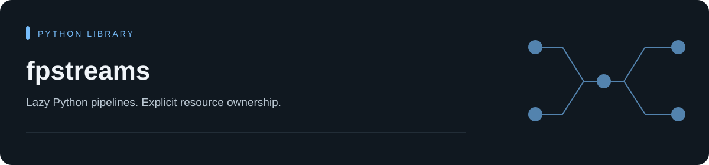

# fpstreams

[Install](#install) · [Quick start](#quick-start) · [Examples](#what-is-in-v2) · [Engines](#execution-engines) · [Documentation](https://steventimes.github.io/fpstreams/)

| Work with | Start with | Execution |
| --- | --- | --- |
| Values and records | `flow()` | Lazy synchronous pipelines |
| Async inputs and calls | `aflow()` | Bounded concurrent work |
| Key/value data | `pairs()` | Per-key collection and aggregation |

[Documentation](https://steventimes.github.io/fpstreams/) · [Browser playground](https://steventimes.github.io/fpstreams/playground/) · [Changelog](https://github.com/steventimes/fpstreams/blob/master/CHANGELOG.md) · [Contributing](https://github.com/steventimes/fpstreams/blob/master/CONTRIBUTING.md)

Process Python objects and async inputs with lazy pipelines, bounded concurrent
work, and explicit resource cleanup.

Python 3.11 or newer is required.

## Install

Install fpstreams from PyPI:

~~~bash
python -m pip install fpstreams
~~~

Prebuilt wheels include the native extension. Building from source requires
Rust 1.85 or newer.

The `async` extra installs `aiofiles` for async file adapters. Core async
pipelines do not require an extra. Install other adapters only when needed:

~~~bash
python -m pip install "fpstreams[async]"   # aiofiles for async file adapters
python -m pip install "fpstreams[arrow]"   # PyArrow and Parquet
python -m pip install "fpstreams[data]"    # NumPy, pandas, and PyArrow
python -m pip install "fpstreams[polars]"  # Polars and PyArrow
~~~

## Quick start

Pass an iterable to `flow()` and consume the result:

~~~python
from fpstreams import flow

result = flow([1, 2, 3]).filter(lambda value: value > 1).map(lambda value: value * 10).to_list()
assert result == [20, 30]
~~~

Use [async pipelines](#asynchronous-pipelines) for asynchronous callbacks and
[record pipelines](#record-pipelines) for grouping. The
[engine guide](#execution-engines) helps diagnose execution routes;
[resource limits](#resource-and-file-safety-controls) apply when processing larger inputs.

### Close an owned iterator

This pipeline takes three matching values and closes its generator before returning.
The generator prints when its `finally` block runs, so cleanup is visible:

~~~python
from fpstreams import flow

def numbers():
    try:
        yield from range(10)
    finally:
        print("source closed")

result = flow(numbers()).filter(lambda value: value % 2 == 0).take(3).to_list()
print(result)
# source closed
# [0, 2, 4]
~~~

See [record pipelines](#record-pipelines) for grouped aggregation, or
[asynchronous pipelines](#asynchronous-pipelines) for concurrent calls.

## When to use fpstreams

For a short, local transformation, a comprehension is often enough. fpstreams
is useful when a pipeline needs grouped aggregations, early termination,
resource cleanup, or async work with a concurrency limit. Small pipelines may
be slower because planning and dispatch add overhead.

Lazy execution does not mean every operation uses constant memory. Sorting,
grouping, and joins need additional state; use the documented limits and spill
options when the input may not fit in memory.

> fpstreams 2 replaces the v1 implementation and retains the compatibility
> aliases listed below.

## What is in v2

- `Flow[T]`: the primary synchronous entry point for lazy value and record
  pipelines, including retained tabular sources.
- `AsyncFlow[T]`: asynchronous transforms with bounded concurrency, ordering,
  timeouts, merging, debouncing, and cleanup of tasks created by the pipeline.
- `Rows[T]`: a record view for expressions, joins, grouping, reshaping, and I/O.
- `Pairs[K, V]`: key/value transforms and per-key collection or aggregation.
- `Collector` and `Aggregator`: single-pass reductions, including named
  multi-aggregation.
- `Option` and `Result`: typed value and error containers.
- Automatic execution planning: fused Python loops, Arrow-native prefixes,
  native Rust kernels for supported scalar plans and guarded relational
  subpaths, and hybrid execution when only part of a plan is native.
- Configured memory and output limits for external sort and partitioned joins/grouping.

The CI matrix targets standard CPython 3.11 through 3.15.
Free-threaded CPython 3.14t and 3.15t are included in an
experimental, non-blocking CI matrix that builds the native extension and checks
core concurrency contracts. These builds are not release-wheel targets;
optional adapter compatibility is outside this matrix.

### Value pipelines

Pipelines are lazy. Transformations build a plan; terminal operations such as
`to_list()`, `aggregate()`, `first()`, and `count()` execute it.

~~~python
from fpstreams import flow, item

squares = (
    flow(range(1, 10))
    .filter(item % 2 == 0)  # Keep even values.
    .map(item * item)  # Square each value.
    .take(3)  # Stop after three results.
    .to_list()
)

assert squares == [4, 16, 36]
~~~

The placeholder expression above is equivalent to two lambdas, but it can also be
compiled by the native engine when the complete plan is supported.

### Named single-pass aggregation

~~~python
from fpstreams import agg, flow

summary = flow([1, 2, 3, 4]).aggregate(
    count=agg.count(),
    total=agg.sum(),
    mean=agg.mean(),
)

assert summary == {"count": 4, "total": 10, "mean": 2.5}
~~~

All named aggregations share one traversal of the source.

### Record pipelines

`flow()` is the main synchronous entry point for both values and records. Record
operations with no conflicting Flow meaning, such as `with_columns()` and
`group_by()`, enter a `Rows` view automatically. Records can be dictionaries,
dataclasses, named tuples, or objects with attributes.

~~~python
from fpstreams import agg, col, flow

orders = [
    {"region": "eu", "status": "paid", "price": 12, "quantity": 2},
    {"region": "us", "status": "paid", "price": 20, "quantity": 1},
    {"region": "eu", "status": "cancelled", "price": 99, "quantity": 1},
    {"region": "eu", "status": "paid", "price": 8, "quantity": 3},
]

revenue = (
    flow(orders)
    .filter(col("status") == "paid")
    .with_columns(revenue=col("price") * col("quantity"))
    .group_by("region")
    .aggregate(
        orders=agg.count(),
        revenue=agg.sum("revenue"),
    )
    .sort_by("region")
    .to_list()
)

assert revenue == [
    {"region": "eu", "orders": 2, "revenue": 48},
    {"region": "us", "orders": 1, "revenue": 20},
]
~~~

Four relation-building names already have general Flow meanings. Call `.rows()`
first when you intend these relational versions:

| Flow call | Flow meaning | Explicit Rows call | Rows meaning |
| --- | --- | --- | --- |
| `drop(count)` | Skip leading items | `rows().drop(*columns)` | Remove record fields |
| `join(separator)` | Join string representations | `rows().join(other, ...)` | Relational join |
| `aggregate(...)` | Execute and return a dictionary | `rows().aggregate(...)` | Build a lazy one-row relation |
| `where(predicate)` | Alias of `filter` | `rows().where(predicate, **equalities)` | Filter records, including field equalities |

Flow also keeps its own output methods. Enter `.rows()` before same-named
methods when you need Rows-specific options, for example
`to_csv(fieldnames=...)` or `to_pandas(batch_size=..., schema=...)`.

`flow(source)` automatically retains concrete PyArrow tables, batches and
readers, pandas DataFrames, Polars frames, and standard
`__arrow_c_stream__`/`__dataframe__` providers. Arrow takes priority when a
custom object implements both protocols, and a pandas index is not emitted as a
record column. Explicit Flow factories cover Arrow, equal-length named columns,
NumPy arrays, dataframe, Polars, typed CSV, and Parquet inputs. The `rows`
namespace continues to provide compatibility CSV, JSONL, SQLite, DB-API, and
record-oriented output methods. CSV and JSONL
inputs accept paths, caller-owned open handles, or replayable opener functions.
The following example needs `fpstreams[arrow]` and an `accounts.parquet` file
with `id`, `status`, and `balance` columns:

~~~python
from fpstreams import col, flow

active = (
    flow.from_parquet("accounts.parquet", columns=["id", "status", "balance"])
    .filter(col("status") == "active")
    .select("id", "balance")
)

active.to_parquet("active-accounts.parquet")
~~~

### Asynchronous pipelines

`map_async` accepts synchronous or asynchronous callables. `concurrency` bounds
in-flight tasks, while `ordered=True` preserves input order.

The core async API needs no optional extra. Install `fpstreams[async]` when you
also need the `aiofiles`-based async file adapters.

~~~python
import asyncio

from fpstreams import aflow

async def fetch(value: int) -> int:
    await asyncio.sleep(0.01)
    return value * 10

async def main() -> None:
    result = await (
        aflow([1, 2, 3, 4])
        .map_async(fetch, concurrency=2, ordered=True)
        .filter(lambda value: value >= 20)
        .to_list()
    )
    print(result)
    # [20, 30, 40]

asyncio.run(main())
~~~

Async iterators consumed by a pipeline are closed, and tasks created by the
pipeline are cancelled, when it finishes, errors, times out, or short-circuits.
Mappers must cooperate with cancellation so cleanup can finish. Offload blocking
work explicitly rather than running it directly inside an async mapper.

### Key/value pipelines

~~~python
from fpstreams import agg, pairs

totals = pairs([("a", 2), ("b", 5), ("a", 3)]).aggregate_values(
    total=agg.sum(),
    average=agg.mean(),
)

assert totals == {
    "a": {"total": 5, "average": 2.5},
    "b": {"total": 5, "average": 5.0},
}
~~~

## Execution engines

The default `auto` engine chooses Python, Rust, Arrow, NumPy, or a combination
for each supported plan. Relational plans may use native shortcuts while keeping
a Python fallback. Pass the terminal you intend to call to `explain()` so it
can include that terminal in its planning decisions:

~~~python
from fpstreams import flow, item

pipeline = flow([1, 2, 3])
plan = pipeline.explain(terminal="count").to_dict()

assert plan["selected_engine"] == "python"
assert plan["complexity"] == "O(1)"
assert plan["data_movement"] == {
    "scans_source": False,
    "copies_source": False,
    "materializes": False,
}
~~~

You can request an engine explicitly when testing parity or diagnosing a plan:

~~~python
from fpstreams import flow, item

pipeline = flow([1, 2, 3]).map(item * 2)
python_result = pipeline.with_engine("python").to_list()
native_result = pipeline.with_engine("native").to_list()

assert python_result == native_result == [2, 4, 6]
~~~

Use `run_with_report()` to get a terminal's value, recorded route, and query-owned
resource counts in one execution. Pairs supports terminals such as
`flow([("a", 1)]).pairs().run_with_report("group_values")`.
Reports include up to 64 child plan and route observations in `report.events`. See the
[execution report guide](https://steventimes.github.io/fpstreams/user-guide/execution-reports/)
for supported terminals and the limits of route reporting.

`report.to_dict()` exports versioned metadata with metric units,
resource scope, and event limits. It excludes the terminal value and does not
rerun the query. See the
[metadata export guide](https://steventimes.github.io/fpstreams/user-guide/execution-reports/#metadata-export-unreleased)
for JSON storage and caller-managed OpenLineage integration.

Use `BoundedExecutor` for a shared submission limit across queries and
`FileCheckpoint` for verified file-partition recovery. See
the [resource controls](https://steventimes.github.io/fpstreams/user-guide/performance/#share-a-submission-budget-unreleased)
and [file-partition recipe](https://steventimes.github.io/fpstreams/user-guide/analytics/#resume-file-partitions-unreleased)
for ownership, memory, and retry semantics.

`flow.unfold` / `aflow.unfold` generate values from explicit state
transitions. `Flow.map_accum` and `AsyncFlow.map_accum` update state while mapping
each input to one output. See the
[state examples](https://steventimes.github.io/fpstreams/reference/flow/#state-driven-generation-and-mapping-unreleased)
for termination, tuple ordering, and mutable-state ownership.

A forced native plan raises `NativeUnsupportedError` if its complete types or
operations cannot run natively. In particular, the presence of an internal
native relational specialization does not make the complete relation eligible
for `with_engine("native")`. An unsupported forced relational plan fails before
claiming its one-shot sources; `auto` selects a legal fallback path.

Identity list and tuple materialization stays in Python. Large, supported integer
sums and numeric range reductions may use Rust in `auto` mode. `count()` uses a
known exact size in O(1) when no operation changes cardinality and the source is
safely reiterable. Use `explain(terminal=...)` to inspect the planned route.

## Resource and file-safety controls

For data larger than memory, use `external_sort(..., buffer_size=...)`, a
partitioned join, or spilled grouping. Spill processing is bounded by its
configuration; it is not a promise that every skewed or many-to-many input will
finish. The defaults are 100,000 rows and 64 MiB per partition, 100,000 matches
per key, 1,000,000 output rows, and three repartition levels.

~~~python
from fpstreams import SpillLimits, agg, rows

accounts = [{"id": 1, "account_id": "a"}, {"id": 2, "account_id": "a"}]
balances = [{"id": 1, "balance": 10}, {"id": 2, "balance": 20}]

limits = SpillLimits(max_output_rows=250_000, max_matches_per_key=10_000)
joined = rows(accounts).join(balances, on="id", partitions=32, limits=limits).to_list()
grouped = (
    rows(accounts)
    .group_by("account_id")
    .spill(partitions=32, limits=limits)
    .aggregate(count=agg.count())
    .to_list()
)

assert sorted((row["id"], row["balance"]) for row in joined) == [(1, 10), (2, 20)]
assert grouped == [{"account_id": "a", "count": 2}]
~~~

Exceeding a configured partition, match, state, record, or output limit raises
`BufferLimitError` and cleans up temporary files.

CSV output is raw by default for machine interchange. For values supplied by
untrusted users and later opened in spreadsheet software, pass
`spreadsheet_safe=True`; strings beginning (after whitespace) with `=`, `+`,
`-`, or `@` are prefixed with a single quote. JSONL reads accept at most 8 MiB
per physical record by default and reject larger lines before JSON parsing;
binary inputs are checked before decoding as well. Pass `max_record_bytes=None`
only for trusted local input when an unlimited record is intentional.

## Source and resource semantics

- Reiterable inputs such as lists can execute more than once.
- Iterators and async iterators are one-shot and raise `FlowConsumedError` on a
  second execution.
- Ordinary generators are not opened or sampled when `flow()` is constructed.
- Generic `__dataframe__` conversion and Polars LazyFrame collection remain
  deferred until execution. A custom `__arrow_c_stream__` provider is imported
  once during construction and treated as one-shot; a PyArrow
  `RecordBatchReader` is also one-shot.
- `flow.defer(factory)` opens a fresh source for every execution.
- Terminal operations release owned iterators, database cursors, and temporary
  files, including on errors and early termination. Async execution also cancels
  and awaits tasks it creates. File adapters distinguish owned resources from
  caller-owned handles; see the [I/O reference](https://steventimes.github.io/fpstreams/reference/io/).

## Editor support

fpstreams includes inline type annotations, docstrings, and the `py.typed` marker.
Select the Python interpreter where fpstreams is installed in your editor to get
method completions, parameter hints, and hover documentation.

Core iterable element types are preserved when optional data adapters are absent. For example,
`flow([1, 2, 3])` is inferred as `Flow[int]`.

### Type contracts and migration

`Flow.reduce()` returns `Any` to type checkers, even with an annotated callback.
The [reduce guide](fpstreams/docs/reference/flow.md#reduce-types) shows typed accumulator alternatives,
including [asynchronous folds](fpstreams/docs/reference/async_flow.md#explicit-asynchronous-accumulator-contract-250).

The result of collecting with `Collectors.averaging()` is typed as `object`. Use the
[explicit averaging contracts](fpstreams/docs/reference/collecting.md#explicit-averaging-operations-250)
when a caller needs a specific result type. See the [2.5.0 migration notes](CHANGELOG.md#250)
before updating existing type-checked code.

Release history and compatibility changes are in the [changelog](CHANGELOG.md).
The [roadmap](https://steventimes.github.io/fpstreams/roadmap/#next-development-steps)
lists development candidates and their acceptance criteria.

## Coding-agent guidance

The [Flow](fpstreams/docs/reference/flow.md#reduce-types),
[async Flow](fpstreams/docs/reference/async_flow.md#explicit-asynchronous-accumulator-contract-250),
and [Collector](fpstreams/docs/reference/collecting.md#explicit-averaging-operations-250)
references describe entry points, typed reductions, and migration contracts.
An independently supplied fpstreams usage skill must match the installed library
version and its API documentation. The skill is distributed separately from
the PyPI wheel and sdist. Neither a package install nor its presence in a
checkout registers it with an agent.

## v1 compatibility

`Stream` remains an alias of `Flow`, `AsyncStream` remains an alias of
`AsyncFlow`, and `ParallelStream` remains an alias of `Flow` to ease imports.
New synchronous code should start with `flow`; use `.rows()` or the `rows`
factory namespace when an explicit relational view or record-specific adapter
is required. Use `aflow` and `pairs` for their respective domains.

v2 breaks parts of the v1 API. The standalone `core` and `ParallelStream`
implementations are gone. `ParallelStream` remains an alias, and `Flow.parallel()`
remains as a compatibility strategy for following maps. New code can call
`map_parallel()` directly or use `map_async()` for asynchronous work.

## Development

~~~bash
uv sync --extra arrow --extra data --extra polars \
  --group build --group test --group lint --group type --group docs

uv run maturin develop --release
uv run pytest -W error --cov=src/fpstreams --cov-branch --cov-report=term-missing
uv run coverage report
uv run ruff check src tests scripts
uv run ruff format --check src tests scripts
uv run mypy src/fpstreams
uv run --no-sync cargo test --manifest-path rust/Cargo.toml
uv run python scripts/build_browser_wheel.py
uv run mkdocs build --strict -f fpstreams/mkdocs.yml
~~~

Performance measurements are maintained locally. Benchmark tools and raw reports
are not part of the public source distribution or GitHub Actions.

The source tree is organized by domain under `src/fpstreams/`: `streams`,
`planning`, `execution`, `collecting`, `tabular`, `expressions`, and `primitives`.
Small top-level modules are compatibility facades, not duplicate implementations.

Contributions are welcome. The
[contributing guide](https://github.com/steventimes/fpstreams/blob/master/CONTRIBUTING.md)
contains the development setup, validation commands, and performance-change
expectations. Use the issue forms for reproducible bugs and scoped proposals;
report security problems through GitHub's private vulnerability reporting flow.

## License

MIT. See the [license](https://github.com/steventimes/fpstreams/blob/master/LICENSE).
